# Hangool ERP — Entity Relationship Diagram

Generated from `supabase/migrations`. Columns shown are keys plus the most important fields;
see the migrations for every column. `auth.users` is Supabase Auth.

Polymorphic links (no foreign key): `approvals.entity_table + entity_id`, `audit_log.table_name + record_id`,
`journal_entries.source_table + source_id`, `notifications.entity_table + entity_id`.

```mermaid
erDiagram
  %% ───────── ACCESS
  AUTH_USERS ||--|| PROFILES : "1:1"
  PROFILES ||--o{ USER_ROLES : has
  ROLES ||--o{ USER_ROLES : granted
  ROLES ||--o{ ROLE_PERMISSIONS : allows
  PROFILES ||--o{ NOTIFICATIONS : receives
  PROFILES ||--o{ AUDIT_LOG : "actor"

  PROFILES {
    uuid id PK "= auth.users.id"
    text full_name
    text email
    bool is_active
  }
  ROLES {
    uuid id PK
    text code UK "owner, general_manager, finance, ... client"
    bool is_staff
  }
  USER_ROLES {
    uuid id PK
    uuid user_id FK
    uuid role_id FK
    uuid assigned_by FK
    timestamptz revoked_at
  }
  ROLE_PERMISSIONS {
    text role_code PK
    text area PK
    bool can_write
    enum scope "all | assigned"
  }
  SETTINGS {
    text key PK
    jsonb value
  }
  NOTIFICATIONS {
    uuid id PK
    uuid user_id FK
    text title
    text link
    timestamptz read_at
  }
  AUDIT_LOG {
    bigint id PK
    uuid actor_id
    enum action
    text table_name
    text record_id
    jsonb old_values
    jsonb new_values
  }

  %% ───────── APPROVALS
  APPROVAL_RULES {
    uuid id PK
    enum approval_type
    int step_order
    text role_code FK
    bool only_above_threshold
  }
  APPROVALS {
    uuid id PK
    uuid request_group
    enum approval_type
    text entity_table
    uuid entity_id
    int step_order
    uuid required_role_id FK
    uuid requested_by FK
    uuid approver_id FK
    enum status
    numeric amount
  }
  ROLES ||--o{ APPROVALS : "required role"
  PROFILES ||--o{ APPROVALS : "requests / decides"

  %% ───────── SALES / CRM / MARKETING
  CAMPAIGNS ||--o{ LEADS : brings
  LEADS ||--o{ FOLLOW_UPS : has
  LEADS |o--o| CLIENTS : "becomes"
  PROPERTIES ||--o{ LEADS : "interest"
  PROFILES |o--o| CLIENTS : "portal login"
  CLIENTS ||--o{ PROJECTS : owns
  CLIENTS ||--o{ CONTRACTS : signs
  CLIENTS ||--o{ MESSAGES : has
  CLIENTS ||--o{ COMPLAINTS : has
  CLIENTS ||--o{ WARRANTY_CLAIMS : has

  CAMPAIGNS {
    uuid id PK
    text name
    enum media_type
    numeric budget
  }
  LEADS {
    uuid id PK
    text name
    enum source
    enum status
    enum interest
    uuid assigned_to FK
    uuid campaign_id FK
    uuid property_id FK
  }
  FOLLOW_UPS {
    uuid id PK
    uuid lead_id FK
    uuid assigned_to FK
    timestamptz due_at
    bool done
  }
  CLIENTS {
    uuid id PK
    uuid user_id FK
    uuid lead_id FK
    text name
  }
  CONTRACTS {
    uuid id PK
    uuid client_id FK
    uuid project_id FK
    text contract_no UK
    numeric contract_value
  }
  MESSAGES {
    uuid id PK
    uuid client_id FK
    uuid project_id FK
    uuid sender_id FK
    text body
  }
  COMPLAINTS {
    uuid id PK
    uuid client_id FK
    uuid project_id FK
    enum status
  }
  WARRANTY_CLAIMS {
    uuid id PK
    uuid client_id FK
    uuid project_id FK
    enum status
  }

  %% ───────── PROJECTS / DESIGN / BOQ
  PROJECTS ||--o{ STAGES : "has (free-text names)"
  PROJECTS ||--o{ PROJECT_MEMBERS : team
  PROFILES ||--o{ PROJECT_MEMBERS : has
  PROJECTS ||--o{ DRAWINGS : has
  DRAWINGS |o--o| DRAWINGS : "previous version"
  PROJECTS ||--o{ CHANGE_REQUESTS : has
  DRAWINGS ||--o{ CHANGE_REQUESTS : has
  STAGES ||--o{ BOQ_ITEMS : has
  CHANGE_REQUESTS ||--o{ BOQ_ITEMS : has
  INVENTORY_ITEMS ||--o{ BOQ_ITEMS : has

  PROJECTS {
    uuid id PK
    text code UK
    uuid client_id FK
    uuid manager_id FK
    enum status
    numeric contract_value
    date end_date
  }
  STAGES {
    uuid id PK
    uuid project_id FK
    text name
    int seq
    numeric budget_amount
    numeric milestone_amount
    int progress_pct
    enum status
  }
  PROJECT_MEMBERS {
    uuid id PK
    uuid project_id FK
    uuid user_id FK
    uuid role_id FK
  }
  DRAWINGS {
    uuid id PK
    uuid project_id FK
    uuid previous_version_id FK
    int version_no
    text storage_path
    enum status
  }
  CHANGE_REQUESTS {
    uuid id PK
    uuid project_id FK
    uuid drawing_id FK
    numeric cost_impact
    enum status
  }
  BOQ_ITEMS {
    uuid id PK
    uuid project_id FK
    uuid stage_id FK
    uuid inventory_item_id FK
    numeric quantity
    numeric unit_price
    numeric amount
    int boq_version
    enum status
  }

  %% ───────── PROCUREMENT / INVENTORY
  STAGES ||--o{ MATERIAL_REQUESTS : has
  MATERIAL_REQUESTS ||--o{ REQUEST_ITEMS : has
  INVENTORY_ITEMS ||--o{ REQUEST_ITEMS : has
  MATERIAL_REQUESTS ||--o{ QUOTES : has
  SUPPLIERS ||--o{ QUOTES : has
  QUOTES |o--o| PURCHASE_ORDERS : selected
  MATERIAL_REQUESTS ||--o{ PURCHASE_ORDERS : has
  SUPPLIERS ||--o{ PURCHASE_ORDERS : has
  PURCHASE_ORDERS ||--o{ SUPPLIER_PAYMENTS : has
  SUPPLIERS ||--o{ SUPPLIER_PAYMENTS : has
  INVENTORY_ITEMS ||--o{ STOCK_MOVEMENTS : has
  PURCHASE_ORDERS ||--o{ STOCK_MOVEMENTS : "stock in"
  PROJECTS ||--o{ STOCK_MOVEMENTS : "issued to"

  SUPPLIERS {
    uuid id PK
    text name
    bool is_active
  }
  MATERIAL_REQUESTS {
    uuid id PK
    uuid project_id FK
    uuid stage_id FK
    uuid requested_by FK
    enum status
  }
  REQUEST_ITEMS {
    uuid id PK
    uuid request_id FK
    uuid inventory_item_id FK
    numeric quantity
  }
  QUOTES {
    uuid id PK
    uuid request_id FK
    uuid supplier_id FK
    numeric total_amount
    bool is_selected
  }
  PURCHASE_ORDERS {
    uuid id PK
    text po_number UK
    uuid request_id FK
    uuid quote_id FK
    uuid supplier_id FK
    numeric total_amount
    enum status
  }
  INVENTORY_ITEMS {
    uuid id PK
    text sku UK
    numeric qty_on_hand "CHECK >= 0"
    numeric reorder_level
  }
  STOCK_MOVEMENTS {
    uuid id PK
    uuid item_id FK
    enum direction
    numeric quantity
    enum condition
    uuid project_id FK
    uuid stage_id FK
  }

  %% ───────── SITE / HR
  PROJECTS ||--o{ DAILY_REPORTS : has
  PROJECTS ||--o{ SITE_ATTENDANCE : has
  LABOURERS ||--o{ SITE_ATTENDANCE : has
  EMPLOYEES ||--o{ SITE_ATTENDANCE : has
  LABOURERS ||--o{ LABOUR_PAYMENTS : has
  PROFILES |o--o| EMPLOYEES : has
  EMPLOYEES ||--o{ LEAVE_REQUESTS : has
  EMPLOYEES ||--o{ PAYROLL : has

  DAILY_REPORTS {
    uuid id PK
    uuid project_id FK
    uuid stage_id FK
    uuid author_id FK
    date report_date
    bool visible_to_client
    uuid client_id UK "device uuid"
    timestamptz happened_at
    timestamptz synced_at
    text device_id
  }
  SITE_ATTENDANCE {
    uuid id PK
    uuid project_id FK
    uuid labourer_id FK
    uuid employee_id FK
    date work_date
    numeric check_in_lat
    numeric check_in_lng
    numeric check_out_lat
    numeric check_out_lng
    uuid client_id UK
    timestamptz synced_at
    text device_id
  }
  LABOURERS {
    uuid id PK
    text name
    numeric daily_rate
  }
  LABOUR_PAYMENTS {
    uuid id PK
    uuid labourer_id FK
    uuid project_id FK
    numeric amount
  }
  EMPLOYEES {
    uuid id PK
    uuid user_id FK
    text job_title
    numeric base_salary
    enum status
  }
  LEAVE_REQUESTS {
    uuid id PK
    uuid employee_id FK
    date start_date
    date end_date
    enum status
  }
  PAYROLL {
    uuid id PK
    uuid employee_id FK
    date period_month
    numeric net
    enum status
  }

  %% ───────── FINANCE / ACCOUNTING
  PROJECTS ||--o{ INVOICES : has
  STAGES |o--o{ INVOICES : "optional"
  INVOICES ||--o{ PAYMENTS : has
  CONTRACTS ||--o{ PAYMENTS : has
  PAYMENTS ||--o| RECEIPTS : has
  BANK_ACCOUNTS ||--o{ PAYMENTS : "into"
  CHART_OF_ACCOUNTS ||--o{ BANK_ACCOUNTS : "GL account"
  CHART_OF_ACCOUNTS ||--o{ JOURNAL_LINES : has
  JOURNAL_ENTRIES ||--o{ JOURNAL_LINES : "balanced"
  CHART_OF_ACCOUNTS ||--o{ EXPENSES : has

  INVOICES {
    uuid id PK
    text invoice_no UK
    uuid project_id FK
    uuid stage_id FK
    enum invoice_type "deposit | milestone | extra"
    numeric amount
    numeric amount_paid
    enum status "draft..overdue"
  }
  PAYMENTS {
    uuid id PK
    uuid invoice_id FK
    uuid bank_account_id FK
    enum method
    numeric amount
    enum status
  }
  RECEIPTS {
    uuid id PK
    uuid payment_id FK
    text receipt_no UK
  }
  SUPPLIER_PAYMENTS {
    uuid id PK
    uuid supplier_id FK
    uuid purchase_order_id FK
    numeric amount
    enum status
  }
  EXPENSES {
    uuid id PK
    uuid account_id FK
    uuid project_id FK
    numeric amount
    enum status
  }
  BANK_ACCOUNTS {
    uuid id PK
    text name
    text kind
    uuid gl_account_id FK
    numeric opening_balance
  }
  CHART_OF_ACCOUNTS {
    uuid id PK
    text code UK
    enum type
    uuid parent_id FK
  }
  JOURNAL_ENTRIES {
    uuid id PK
    bigint entry_no UK
    date entry_date
    text source_table
    uuid source_id
    enum status
  }
  JOURNAL_LINES {
    uuid id PK
    uuid entry_id FK
    uuid account_id FK
    uuid project_id FK
    numeric debit
    numeric credit
  }

  %% ───────── REAL ESTATE
  PROJECTS |o--o{ PROPERTIES : "built by Hangool"
  PROPERTIES ||--o{ PROPERTY_UNITS : has
  PROPERTIES ||--o{ RENTAL_AGREEMENTS : has
  TENANTS ||--o{ RENTAL_AGREEMENTS : has
  RENTAL_AGREEMENTS ||--o{ RENT_PAYMENTS : has
  PROPERTIES ||--o{ SALE_AGREEMENTS : has
  BUYERS ||--o{ SALE_AGREEMENTS : has
  PROPERTIES ||--o{ VIEWINGS : has
  LEADS |o--o{ VIEWINGS : has

  PROPERTIES {
    uuid id PK
    text title
    enum listing_type
    numeric price
    enum status
  }
  PROPERTY_UNITS {
    uuid id PK
    uuid property_id FK
    text unit_no
    numeric rent_amount
    enum status
  }
  TENANTS {
    uuid id PK
    uuid user_id FK
    text name
  }
  BUYERS {
    uuid id PK
    uuid user_id FK
    text name
  }
  RENTAL_AGREEMENTS {
    uuid id PK
    uuid property_id FK
    uuid unit_id FK
    uuid tenant_id FK
    numeric monthly_rent
    enum status
  }
  SALE_AGREEMENTS {
    uuid id PK
    uuid property_id FK
    uuid buyer_id FK
    numeric sale_price
    enum status
  }
  RENT_PAYMENTS {
    uuid id PK
    uuid rental_agreement_id FK
    date period_month
    numeric amount
    enum status
  }
  VIEWINGS {
    uuid id PK
    uuid property_id FK
    uuid lead_id FK
    timestamptz scheduled_at
    enum status
  }

  %% ───────── DOCUMENTS
  DOCUMENTS ||--o{ DOCUMENT_VERSIONS : has
  DOCUMENTS ||--o{ DOCUMENT_ACCESS : has
  ROLES ||--o{ DOCUMENT_ACCESS : has
  PROJECTS |o--o{ DOCUMENTS : has
  CLIENTS |o--o{ DOCUMENTS : has
  EMPLOYEES |o--o{ DOCUMENTS : has
  SUPPLIERS |o--o{ DOCUMENTS : has
  PROPERTIES |o--o{ DOCUMENTS : has

  DOCUMENTS {
    uuid id PK
    text title
    text category
    uuid project_id FK
    uuid client_id FK
    uuid employee_id FK
    uuid supplier_id FK
    uuid property_id FK
    int current_version
  }
  DOCUMENT_VERSIONS {
    uuid id PK
    uuid document_id FK
    int version_no
    text storage_bucket
    text storage_path
  }
  DOCUMENT_ACCESS {
    uuid id PK
    uuid document_id FK
    uuid role_id FK
    uuid user_id FK
    bool can_edit
  }
```

## Changes from the Prisma blueprint

| Area | Change |
|---|---|
| Login | `users` + password hash → Supabase Auth (`auth.users`) + `profiles`. TOTP 2FA via Supabase MFA; RLS requires `aal2` once a factor is verified. |
| Roles | 16 roles incl. `general_manager`, `real_estate_officer`, `employee`. `role_permissions` matrix drives RLS and the menu. Last owner cannot be removed. |
| Stages | `name` is free text; defaults live in `settings.default_stage_names`. Added `progress_pct`, `actual_start`. |
| Invoices | Statuses draft / pending / partially_paid / paid / overdue / cancelled; `invoice_type` deposit / milestone / extra; `stage_id` optional and not unique. |
| Real estate | `properties` + `property_units`, `tenants`, `buyers`, `rental_agreements`, `sale_agreements`, `rent_payments`, `viewings`. |
| Accounting | `chart_of_accounts`, `journal_entries`, `journal_lines` (must balance to post), `bank_accounts`, `expenses`. Invoices, payments, deliveries, supplier payments, expenses, rent and payroll post automatically. |
| Documents | `documents` + `document_versions` + `document_access` replace `employee_documents`. |
| Offline | `client_id` (device uuid, unique), `happened_at`, `synced_at`, `device_id` on `daily_reports` and `site_attendance`; GPS check-in/out on attendance. |
| Approvals | `approval_rules` + `approvals` grouped by `request_group`; self-approval skipped; threshold adds owner step; status changes that need approval are locked to the engine. |
| Audit | One trigger on every important table writes `audit_log`. |
